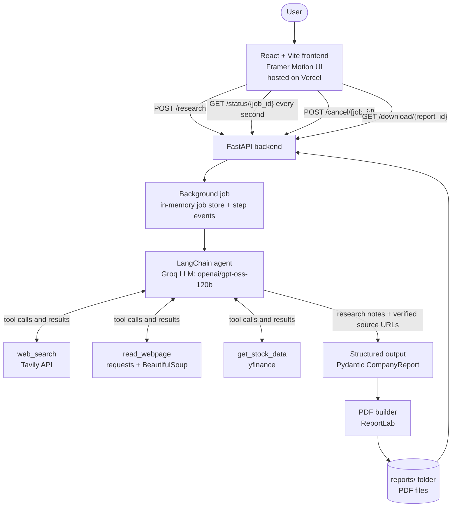
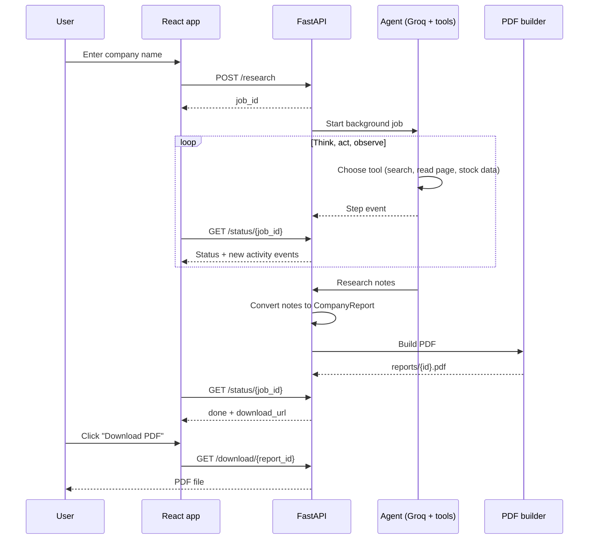

# Company Research Agent

An AI agent that researches any company on the web and turns what it finds into a downloadable PDF report: what the company does, products, business model, leadership, competitors, market valuation, recent news and risks.

**Live demo (frontend):** https://company-research-agent-sand.vercel.app/

> The live demo is the React frontend. Generating a report also needs the FastAPI backend to be running and reachable. To try the full app, follow [Run it locally](#run-it-locally).

## How it works

The agent uses **tool calling**. The LLM can't browse the web or fetch stock data by itself, so it is given tools. At each step it decides which tool to call, your code runs it, and the result goes back to the model. This loop repeats until the model has enough information to write its research notes.

1. You enter a company name in the React app.
2. FastAPI starts a background job and returns a job ID immediately.
3. The LangChain agent (Groq LLM) searches the web, reads pages and pulls market data.
4. The notes are converted into a structured report (Pydantic schema).
5. A PDF is built with ReportLab, and the frontend shows a download link.
6. While this runs, the frontend polls the job and shows each real agent step in a live activity feed.

## Architecture



### Request flow



## Tech stack

| Layer | Technology |
|---|---|
| Frontend | React, Vite, Framer Motion |
| Backend | Python, FastAPI, Uvicorn |
| Agent | LangChain / LangGraph, Groq API (`openai/gpt-oss-120b`) |
| Tools | Tavily (web search), requests + BeautifulSoup (page reader), yfinance (market data) |
| Report | Pydantic (schema), ReportLab (PDF) |

## Features

- Tool-calling research agent with a capped tool budget, so it can't loop forever
- Live activity feed showing each real step the agent takes, typed out as it happens
- Cancel button that stops the agent between steps
- Structured report with a key-financials table and clickable sources
- Source URLs are checked against what the tools actually returned, so the agent can't invent links
- Past reports saved in the browser for re-download
- Animated UI: gradient background, tilting cards, light and dark mode

## Project structure

```
Company Research Agent/
├── Backend/
│   ├── main.py          # FastAPI app: jobs, status, cancel, download
│   ├── agent.py         # LangChain agent, step events, structured output
│   ├── tools.py         # web_search, read_webpage, get_stock_data
│   ├── schemas.py       # CompanyReport (Pydantic)
│   ├── pdf_builder.py   # ReportLab PDF layout
│   ├── reports/         # generated PDFs (not committed)
│   ├── .env             # API keys (not committed)
│   └── .env.example     # template for the keys
└── Frontend/
    └── frontend/
        └── src/
            ├── App.jsx  # UI, animations, polling, activity feed
            └── App.css
```

## API

| Method | Endpoint | Purpose |
|---|---|---|
| `POST` | `/research` | Start a job. Body: `{"company": "NVIDIA"}`. Returns `{"job_id": "..."}` |
| `GET` | `/status/{job_id}` | Job status (`running`, `done`, `error`, `cancelled`), activity events, and `download_url` when done |
| `POST` | `/cancel/{job_id}` | Ask the agent to stop after its current step |
| `GET` | `/download/{report_id}` | Download the generated PDF |

Interactive docs are available at `http://localhost:8000/docs` when the backend is running.

## Run it locally

You need **Python 3.10+**, **Node.js (LTS)**, a [Groq API key](https://console.groq.com) and a [Tavily API key](https://tavily.com).

### 1. Backend

```powershell
cd Backend
python -m venv env
.\env\Scripts\Activate.ps1
python -m pip install fastapi uvicorn langchain langchain-groq langchain-core tavily-python yfinance beautifulsoup4 requests reportlab python-dotenv
```

Create `Backend/.env` (never commit this file):

```
GROQ_API_KEY=your-groq-key
TAVILY_API_KEY=your-tavily-key
```

Start the server:

```powershell
uvicorn main:app --reload
```

It runs at `http://localhost:8000`.

### 2. Frontend

In a second terminal:

```powershell
cd Frontend/frontend
npm install
npm install framer-motion
npm run dev
```

Open `http://localhost:5173`.

## Limitations

- **Free-tier limits:** Groq's free tier has a tokens-per-minute cap. If a report fails with a rate-limit message, wait a minute and try again.
- **Accuracy:** reports are generated by an AI from public web pages. Check important figures against the linked sources.
- **Private companies:** market data comes from stock tickers, so private companies get less financial detail.
- **Job storage:** jobs are kept in memory and are lost when the backend restarts.

## Possible improvements

- Persist jobs and reports in a database
- Add a news-specific tool and charts in the PDF
- Stream events with Server-Sent Events instead of polling
- Deploy the backend so the hosted frontend works end to end

## Author

Built by [Fahadqureshi0](https://github.com/Fahadqureshi0).
